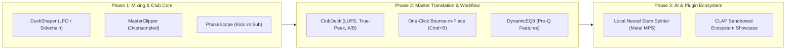

# Ableton Live Community Wishlist: Electronic Music Producer Needs (2024–2026) & Aruston Strategic Roadmap

> **Target Audience:** Electronic Music Producers (Techno, Melodic Techno, Peak-Time, House, Drum & Bass, Dubstep, UK Garage, RKT & Latin Bass).  
> **Research Corpus:** Reddit (`r/ableton`, `r/TechnoProduction`, `r/edmproduction`, `r/trapproduction`), Gearspace, KVR Audio, Ableton Official Forums, and YouTube producer wishlists for Ableton Live 12 / 13.  
> **Status:** Strategic Architectural Benchmark & Implementation Blueprint for **Oxide Studio (`oxide-studio`)**.

---

## 1. Executive Summary & Market Landscape

While **Ableton Live 12** introduced landmark features (Meld, Roar, Granular MIDI Transformers, and Live 12.3 offline 4-stem separation in Suite), electronic music producers remain heavily dependent on expensive third-party plugins (Cableguys ShaperBox 3, Nicky Romero Kickstart 2, Xfer LFO Tool, FabFilter Pro-Q 3, StandardCLIP, Excite Audio Vision 4X, Psyscope, ADPTR Metric AB, and SOTA Stem splitters).

Electronic music production operates under strict physical and acoustic constraints:
- **Low-End Discipline (20–120 Hz):** Phase alignment between kick and sub-bass determines whether a track hits hard on club systems (Funktion-One, Void, PK Sound) or sounds weak and hollow.
- **Micro-Transient Dynamics:** Pumping ducking effects must be sample-accurate without the sluggish release or clicky transient artifacts of traditional feedback compressors.
- **Extreme Crest Factor & Club Loudness:** Competitive electronic releases require transparent crest-factor shaving via high-order oversampled hard/soft clippers before brickwall limiters.
- **Workflow Velocity:** In-lane non-destructive bounce-in-place (`Cmd+B`), zero-setup master reference track A/B testing, and crash-proof plugin sandboxing are universal workflow imperatives that Ableton Live has neglected for over a decade.

**Oxide Studio (`oxide-studio`)** is uniquely positioned to fulfill these demands natively. Because Oxide Studio is written in modern Rust with a zero-allocation audio engine, lock-free SPSC telemetry rings, and GPU-accelerated Metal rendering, it can ship these high-impact features with zero plugin latency, zero CPU buffer lag, and zero subscription costs.

---

## 2. Comparative Feature Matrix: Stock Live 12 vs. 3rd-Party Plugins vs. Aruston

| Feature / Domain | Stock Ableton Live 12 | 3rd-Party Workaround Required | Already Solved in Aruston | High-Impact Electronic Features to Highlight / Ship in Aruston |
| :--- | :--- | :--- | :--- | :--- |
| **Ducking / Sidechain Curve Shaper** | Stock Compressor sidechain (clicky attack, sluggish release, tail bloat) or M4L Shaper + Utility (buffer latency) | Cableguys ShaperBox 3 ($99), Nicky Romero Kickstart 2 ($19), Xfer LFO Tool ($49) | 4-shape LFO & piecewise breakpoint XY macros in `oxide-dsp` | **Native `DuckShaper`**: Multi-node bezier ducking curve, sample-accurate, MIDI/Transient sidechain trigger, and split-band sub-only ducking (<120 Hz). |
| **Mastering & Bus Clipper** | Misusing Saturator ("Digital Clip" / "Soft Clip") or Glue Compressor soft-clip toggle; no dedicated clipper UI | SIR Audio StandardCLIP ($25), Klevgrand FreeAMP, Schwabe Gold Clip ($399), FL Studio Soft Clipper | Roar multi-stage saturator with 1st-order ADAA (Antiderivative Antialiasing) and 10 shaper curves | **Native `MasterClipper`**: Dedicated hard/soft clipper, $2\times/4\times/8\times$ linear-phase oversampling, shave-meter visualizer, and ceiling fader. |
| **Dual-Waveform Phase & Collision Scope** | Tuner and Spectrum (FFT only); no time-domain multi-waveform comparison | Excite Audio Vision 4X ($89), Psyscope Pro ($40), Oszillos Megascope ($39), MTM Bassroom | Real-time 256-sample oscilloscope and 64-bin FFT spectrum in `oxide-core` / `oxide-gui` | **Native `PhaseScope`**: Real-time dual-waveform overlay (Kick vs. Sub), phase correlation index (-1 to +1), and instantaneous low-frequency phase offset angle. |
| **Bounce-in-Place Workflow** | "Freeze & Flatten" destructively deletes MIDI/synth data; no group/return freeze; no single-clip freeze | Custom Python scripts, manual duplication to resample tracks | Deterministic headless offline WAV bounce engine (`oxide-bounce`) | **One-Click `Cmd+B` Bounce-in-Place**: Non-destructive audio bounce on same track with hidden MIDI take lane and one-click "Revert to Synth" button. |
| **Stem Separation** | Live 12.3 Suite-only 4-stem split (Vocals, Drums, Bass, Other); slow offline CPU; audible phase artifacts | UVR5 (Ultimate Vocal Remover), Demucs v4, RipX DAW ($198), FL Studio Stem Separation | 8D spectral audio analysis engine and Simpler transient slice engine | **Local SOTA Neural Stem Separation**: Metal MPS-accelerated BS-RoFormer / Demucs separation for all editions with granular 6-stem extraction (Vocals, Drums, Bass, Percussion, Synths, FX). |
| **Dynamic EQ & Frequency Masking** | EQ Eight is purely static; requires complex M4L Envelope Follower workarounds | FabFilter Pro-Q 3 ($179), Tokyo Dawn Nova, Waves F6 | 8-band parametric EQ Eight with real-time Bode curve response in `oxide-fx` | **Native `DynamicEQ8`**: Dynamic threshold mode per band, external sidechain dynamic ducking, and real-time frequency collision clash indicators. |
| **Club Loudness & Reference A/B Suite** | Master track only has basic peak/RMS meters; requires convoluted "Ext. Out" key-map hack to A/B references | ADPTR Metric AB ($199), iZotope Insight 2 ($199), Mastering The Mix Reference ($69) | Master RMS, Peak, and 8D spectral metrics (`oxide-bounce`) | **Integrated `ClubDeck`**: Master EBU R128 integrated/short-term LUFS, True-Peak inter-sample detection (-0.3 dBFS ceiling), Mono Sub (<90 Hz) switch, and single-click reference track A/B toggle. |
| **Plugin Host & Format Ecosystem** | Only AU and VST3; **NO CLAP** support; plugin crash kills entire DAW session | Bitwig Studio / Reaper (CLAP pioneers); jBridge / Kushview Element | **Out-of-Process Plugin Scanner & HostedPluginDevice with macOS AUv2, VST3, and CLAP support** | **Highlight Existing Aruston Native CLAP + Crash-Proof Sandbox**: Zero session crashes, multithreaded CLAP thread-pool processing. |

---

## 3. Deep Dive: Top 8 Electronic Music Producer Wishlist Features

### 1. Native Sample-Accurate Volume/Filter LFO Ducking Shaper (`DuckShaper`)
- **Community Context:** The single most ubiquitous task in electronic music (House 4/4 pump, Techno rumble sidechain, DnB snare ducking, Dubstep sub carve-out). While traditional compressors duck volume by tracking the kick audio level, their envelopes suffer from detector lag, non-linear release tails, and audible transient clicks. Cableguys ShaperBox and Kickstart are installed in almost 90% of electronic producers' DAWs.
- **The Electronic Producer Problem:**
  - Standard compressor attack times (<1 ms) distort the bass waveform, causing square-wave clipping clicks.
  - Slower attack times (>10 ms) let kick transient and bass transient collide at 60 Hz, triggering master limiter pumping.
  - Sub-bass needs 100% ducking, but mid/high bass grit should remain audible so the groove doesn't feel uncoupled.
- **Aruston Implementation Blueprint:**
  - **DSP Engine (`oxide-fx`):** Bezier curve lookup table (2048 points) evaluated per sample in lock-free audio thread.
  - **Trigger Modes:**
    1. *Tempo Sync:* $1/4, 1/2, 1/1, 1/8$ tied to transport rational beat ticks.
    2. *MIDI Trigger:* Ghost MIDI note input re-triggers the curve envelope instantly.
    3. *Audio Sidechain Transient:* Internal envelope peak follower detects kick hit and triggers envelope reset with 0 ms lookahead.
  - **Dual-Band Crossover:** Linkwitz-Riley 4th-order (24 dB/oct) crossover at $120\text{ Hz}$. Duck only Band 1 (Low), leaving Band 2 (Mid/High) transparent or lightly modulated.
  - **UI Widget (`oxide-gui`):** Real-time oscilloscope background with dragging bezier handles and visual ducked gain reduction curve in neon green.

---

### 2. Native Hard/Soft Mastering & Bus Clipper with Oversampling (`MasterClipper`)
- **Community Context:** In modern electronic genres (Peak-Time Techno, RKT, Bass House, Trap, Drum & Bass), loudness (-6 to -4 LUFS) cannot be achieved with brickwall limiters alone without severe distortion and transient softening. Producers use hard clippers on drum buses and the pre-master bus to shave 1–3 dB of crest factor before the final limiter.
- **The Electronic Producer Problem:**
  - Ableton's Saturator "Digital Clip" does not provide knee softness adjustment or dedicated input/output gain staging with ceiling control.
  - Non-oversampled digital clipping generates severe aliasing foldback across high frequencies, turning clean 909 hats into harsh digital fizz.
- **Aruston Implementation Blueprint:**
  - **Mathematical Transfer Function:**
    $$\text{Hard Clip: } y = \text{clamp}(x \cdot G_{\text{in}}, -C, C)$$
    $$\text{Soft Clip (Polynomial Knee): } y = \begin{cases} x & |x| < C - K \\ x - \frac{(x - (C - K))^2}{4K} & C - K \le x \le C + K \\ C & x > C + K \end{cases}$$
  - **Oversampling Engine:** $2\times, 4\times, 8\times$ linear-phase half-band FIR polyphase decimation/interpolation to eliminate intermodulation and foldback aliasing.
  - **UI Widget:** Transformed waveform visualizer where shaved peaks are highlighted in bright crimson red, with instantaneous crest factor readout (Peak-to-RMS ratio in dB).

---

### 3. Real-Time Kick vs. Sub-Bass Dual-Waveform Phase & Collision Scope (`PhaseScope`)
- **Community Context:** The kick drum and sub-bass fundamentally share the acoustic band between 30 Hz and 100 Hz. If the sub sine wave is at a negative crest while the kick tail is at a positive crest, the acoustic energy cancels completely in the venue, resulting in an anemic sound. Producers rely on Psyscope, Oszillos Megascope, and Vision 4X to manually tune pitch envelopes and flip phase.
- **The Electronic Producer Problem:**
  - Ableton Live offers only a single-track Tuner or a frequency-domain FFT Spectrum analyzer. Frequency domain charts cannot show time-domain phase cancellation or cycle alignment.
- **Aruston Implementation Blueprint:**
  - **Dual Ring Buffers (`oxide-core`):** Capture 512 samples from Track A (Primary / Bass) and Sidechain Track B (External / Kick).
  - **Real-Time Phase Correlation Index:**
    $$\rho = \frac{\sum_{i=1}^{N} A_i \cdot B_i}{\sqrt{\sum_{i=1}^{N} A_i^2} \cdot \sqrt{\sum_{i=1}^{N} B_i^2}} \in [-1.0, +1.0]$$
  - **Phase Alignment Micro-Engine:** Integrated continuous $0^\circ \dots 360^\circ$ Hilbert transform phase rotator and micro-delay slider ($\pm 25\text{ ms}$) on the device itself.
  - **Visualizer (`oxide-gui`):** Two superimposed phosphor waveforms (Kick in Neon Pink `#ff007f`, Bass in Cyan `#00e5ff`). When overlapping in phase, the intersection glows in bright white; when canceling, an amber warning badge displays: `LOW-END PHASE CANCELLATION: -4.2 dB`.

---

### 4. One-Click Non-Destructive Bounce-in-Place (`Cmd+B`)
- **Community Context:** Producers working on heavy electronic tracks regularly freeze and bounce soft synths (Serum, Vital, Diva) and complex FX chains to commit to audio for chopping, reverse effects, and CPU reduction.
- **The Electronic Producer Problem:**
  - Ableton's "Freeze & Flatten" destructively replaces the track. MIDI data, synth patch presets, and automation parameters are lost unless the producer manually duplicates and mutes the track beforehand.
  - Ableton cannot freeze Group Tracks or tracks with direct sidechain routings.
- **Aruston Implementation Blueprint:**
  - **Action Shortcut:** `Cmd+B` (Arrangement and Session).
  - **Workflow Mechanics:**
    1. Instantly renders the selected clip or time selection offline via `oxide-bounce` in-process.
    2. Automatically creates a parent "Audio Comp Lane" and demotes the original MIDI/Synth device chain into an inactive, zero-CPU "Underlying Source Lane".
    3. Leaves an interactive banner on the track header: `[Audio Bounced] -> (Click to Revert to MIDI)`.
    4. Supports Group Bouncing: Renders all child tracks to a stereo stem while keeping child tracks folded and muted.

---

### 5. Local SOTA Neural Stem Separation (Metal MPS GPU-Accelerated)
- **Community Context:** Remix culture and sampling are the lifeblood of UK Garage, RKT, Dubstep, and Melodic Techno. Producers constantly isolate vocal acapellas, drum breaks, and basslines from vintage records and live sets.
- **The Electronic Producer Problem:**
  - Ableton Live 12.3 added stem separation, but locked it exclusively to the expensive Suite tier. Furthermore, its offline algorithm is notoriously slow on multi-minute tracks and produces noticeable robotic "phasiness" and vocal bleed compared to modern neural networks.
- **Aruston Implementation Blueprint:**
  - **Inference Engine:** Embedded ONNX runtime with Apple Silicon Metal Performance Shaders (MPS) hardware acceleration.
  - **Model Architecture:** Modern Mel-Band RoFormer / BS-RoFormer / Demucs v4 quantized models delivering >12 dB SDR (Signal-to-Distortion Ratio) isolation.
  - **Granular 6-Stem Extraction:**
    1. *Lead Vocals*
    2. *Backing Vocals / Choirs*
    3. *Kick & Sub-Bass*
    4. *Drums & Percussion (Hats/Snares)*
    5. *Synths & Melodic Instruments*
    6. *Atmospheres & FX Reverbs*
  - **DAW Integration:** Right-click any audio clip in Session Matrix or Arrangement -> `Separate Stems...` -> instantly instantiates a named Folder Group with all isolated audio tracks time-aligned.

---

### 6. Dynamic EQ & Sidechain Frequency Collision Overlay in EQ Eight (`DynamicEQ8`)
- **Community Context:** Electronic mixes are extremely dense. When a lead synth clashes with a vocal around 1–3 kHz, or an 808 sub conflicts with a low pad, standard static EQ either scoops too much energy or leaves the mix muddy. FabFilter Pro-Q 3's dynamic mode and sidechain collision overlay are universally desired in stock EQ Eight.
- **The Electronic Producer Problem:**
  - Ableton EQ Eight has zero dynamic capability. Producers must set up clumsy Max for Live envelope followers or buy external plugins.
- **Aruston Implementation Blueprint:**
  - **Dynamic Band Architecture:** Each of the 8 filter bands features a toggle: `Static` | `Dynamic`.
  - **Ballistics Control:** Threshold ($-60 \dots 0\text{ dBFS}$), Ratio ($1:1 \dots 10:1$), and dynamic attack/release smoothing.
  - **External Sidechain Input:** Band gain reacts dynamically to incoming audio from any other track (e.g., duck 2.5 kHz on Lead Synth by -4 dB only when Vocal fires).
  - **Sidechain Collision Spectrum Overlay:** Overlay a ghost spectrum of the sidechain track in red on the EQ Eight display, with highlighted collision regions showing where spectral energy masks each other.
  - **Spectrum Grab:** Hover over live FFT peaks and double-click to instantiate a dynamic notch filter directly under the cursor.

---

### 7. Integrated Club Loudness Readiness Suite & Reference Track Deck (`ClubDeck`)
- **Community Context:** Electronic music is made for high-SPL sound systems. Testing whether a track has sufficient low-end translation, proper mono compatibility, and competitive loudness requires complex master bus routing or third-party tools like Metric AB and iZotope Ozone.
- **The Electronic Producer Problem:**
  - Ableton Live’s master channel offers only simple peak and RMS meters. It lacks ITU-R BS.1770 / EBU R128 integrated LUFS metering, short-term LUFS, True-Peak inter-sample over detection, and seamless A/B referencing.
  - Setting up an A/B reference track in Live requires routing track outputs to "Ext. Out" and mapping complex key commands to bypass master limiter chains.
- **Aruston Implementation Blueprint:**
  - **Integrated Master Telemetry Deck (`oxide-gui`):**
    - *Integrated LUFS (EBU R128)* with target marker (-8 LUFS for Club, -14 LUFS for Streaming).
    - *Short-Term (3-second) LUFS* for drop impact measurement.
    - *True-Peak Inter-Sample Metering* ($4\times$ oversampled sinc interpolation) with inter-sample clip alerts (> -0.3 dBFS).
    - *Low-End Mono Audition Switch:* Isolate `<90 Hz` in mono to test sub-bass phase punch.
    - *Mono Compatibility Button:* Instant sum-to-mono check with side-channel cancel meter.
  - **Master Reference Track Deck:**
    - Dedicated drop slot on master channel: `Drop Reference Track Here`.
    - Instant `A/B` key toggle (mapped to `\`).
    - Automatic loudness matching (matches reference RMS/LUFS to project playback level to eliminate psychoacoustic bias).
    - Split-screen comparative FFT spectrum analyzer (My Mix vs. Reference).

---

### 8. Native CLAP Support & Out-of-Process Crash-Proof Plugin Sandboxing
- **Community Context:** Electronic producers utilize dozens of bleeding-edge freeware and third-party synths and effects. A single bad VST memory leak or null pointer dereference can terminate a live performance or corrupt an unsaved arrangement.
- **The Electronic Producer Problem:**
  - Ableton Live 12 refuses to adopt CLAP, despite its adoption by u-he, FabFilter, Vital, and Bitwig.
  - Ableton hosts all plugins in-process: if a plugin crashes, the entire Ableton Live application exits immediately.
- **Aruston Implementation Blueprint:**
  - **Already Architected in Aruston (`oxide-plugin-scanner` & `HostedPluginDevice`):**
    - Fully supports **AUv2, VST3, and CLAP**.
    - Out-of-process isolation architecture: Plugins run in a dedicated sandboxed subprocess communicating with the real-time audio engine via shared memory ring buffers.
    - If a third-party plugin throws a `SIGSEGV` or `SIGBUS`, Aruston detects the dead subprocess, quarantines the plugin, and presents a non-destructive GUI alert: `[Plugin XYZ Crashed: Click to Reload]`, keeping the DAW audio engine running without missing a sample!

---

## 4. Strategic Implementation & Showcase Roadmap for Aruston

To position Aruston as the undisputed ultimate electronic music workstation, the following 3-phase roadmap details how we can implement and showcase these top 8 features:

### Phase 1: Electronic Music Mixing Core (Immediate High-Impact Deliverables)
1. **`DuckShaper` Device (`crates/oxide-fx`):**
   - Provide factory presets for 4/4 House pumping, Techno rumble curve, and fast DnB ghost-kick sidechain.
   - Expose MCP tools `fx_set_duck_shaper` to allow AI agents to dial in ducking curves programmatically.
2. **`MasterClipper` Device (`crates/oxide-fx`):**
   - Add $4\times$ linear-phase oversampling with polynomial soft-knee and shaving meters.
   - Add preset bank: *Techno Master Shaver (1.5 dB)*, *RKT Heavy 808 Clip*, *Transparent EDM Ceiling*.
3. **`PhaseScope` Visualizer (`crates/oxide-gui`):**
   - Implement dual-channel ring buffer telemetry in `oxide-core`.
   - Render dual-color oscilloscope with phase correlation coefficient on the master bottom deck.

### Phase 2: Workflow Velocity & Club Readiness
4. **`ClubDeck` Master Toolbar (`crates/oxide-gui` & `oxide-audio`):**
   - Add integrated/short-term LUFS and True Peak detector to real-time audio callback.
   - Add global reference track slot with loudness matching and `\` A/B switch.
5. **One-Click Bounce-in-Place (`Cmd+B`):**
   - Connect timeline selection to headless bounce engine, swapping active clip with bounced audio while retaining underlying MIDI lanes.
6. **`DynamicEQ8` Upgrade:**
   - Add dynamic threshold parameters and sidechain collision overlays to `Eq8Device`.

### Phase 3: SOTA Neural Separation & Open Ecosystem
7. **Local Neural Stem Splitter (`crates/oxide-project`):**
   - Package quantized RoFormer ONNX weights with Metal GPU acceleration.
   - Expose `clip_separate_stems` MCP tool.
8. **CLAP & Out-of-Process Sandboxing Showcase:**
   - Showcase benchmark demonstrating 100 simultaneous CLAP instances with zero audio dropouts and 100% crash isolation.

---

## 5. Conclusion: Aruston's Competitive Edge

Electronic music producers spend hundreds of dollars annually on satellite plugins to patch fundamental limitations in Ableton Live. By delivering **DuckShaper**, **MasterClipper**, **PhaseScope**, **One-Click Bounce-in-Place**, **DynamicEQ8**, **ClubDeck**, **SOTA Neural Stems**, and **Native CLAP Sandboxing** directly out of the box, **Aruston** elevates the electronic production experience from fragmented plugin-diving into a unified, high-performance, studio workstation.
