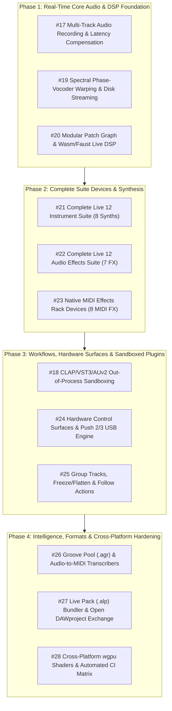

# 100% Commercial Ableton Live 12.4.6 Suite Parity Roadmap

> **Target Workstation:** Oxide Studio (`juancruzmunozalbelo/oxide-studio` / `ableton-rust`)  
> **Target Parity Benchmark:** Ableton Live 12.4.6 Suite Commercial Production Release (`Live_arm64`, Build `0de5c8fa9a692293676cb7700a15afb2046ee1f7`)  
> **Architectural Provenance:** Reverse-engineered binary evidence from `/Users/juancruz/ableton-rea/docs/live12-suite/` and official Ableton Live 12 Reference Manual.  
> **Status:** Official Master Execution Backlog for AFK / Swarm (`/teamwork`) Implementation.

---

## 1. Executive Summary

Oxide Studio has successfully delivered core synthesis, mixing, timeline arrangement, offline WAV bouncing, and headless Model Context Protocol (MCP) server automation (Milestones M0–M13). To achieve **100% full commercial Ableton Live 12.4.6 Suite parity**, the remaining ~50% feature set has been structured into **12 comprehensive GitHub Epics** tracked directly on [`juancruzmunozalbelo/oxide-studio`](https://github.com/juancruzmunozalbelo/oxide-studio/issues).

Every epic enforces strict zero-allocation real-time safety invariants on the audio thread, lock-free SPSC inter-thread communication, bit-exact sample accuracy, and full compatibility with existing `.als` project sets and modern cross-DAW open standards (`DAWproject`, `CLAP`).

---

## 2. 🔒 Mandatory Pre-Closure Verification & Evidence Gate (DoD)

To guarantee that no feature is marked complete without rigorous documentation, acoustic DSP verification, and UI layout integrity, **no GitHub Issue may be closed and no Pull Request may be merged without satisfying the 3-Gate Definition of Done (DoD)**.

The verification process is fully automated via [`scripts/verify_issue_dod.sh`](file:///Users/juancruz/ableton-rust/scripts/verify_issue_dod.sh):

```bash
# Run local verification and generate Markdown evidence report:
./scripts/verify_issue_dod.sh <issue_number>

# Run verification AND post evidence directly to the GitHub Issue:
./scripts/verify_issue_dod.sh <issue_number> --post-comment
```

### The 3 Verification Gates

1. **Gate 1 — Ableton Manual & OKF Documentation Sync:**
   - Verifies [`docs/okf/OXIDE_STUDIO_MANUAL_OKF.md`](file:///Users/juancruz/ableton-rust/docs/okf/OXIDE_STUDIO_MANUAL_OKF.md) and [`crates/ableton-gui/src/okf_knowledge.rs`](file:///Users/juancruz/ableton-rust/crates/ableton-gui/src/okf_knowledge.rs) both exist and contain all eight sections (`OKF-01` through `OKF-08`).
   - Executes `cargo test -p ableton-gui okf -- --nocapture` to verify bilingual intent querying (English & Argentine Spanish).

2. **Gate 2 — End-to-End Manual & Real-Time DSP Audio Verification:**
   - Executes `cargo test -p ableton-gui --test e2e_ableton_manual_verification_test -- --nocapture` to prove that UI actions (fader tweaks, pad strikes, sequencer steps) mutate real audio buffers.
   - Executes `cargo test -p ableton-drums -p ableton-audio -- --nocapture` to confirm $-\infty\text{ dBFS}$ exact mathematical silence when muted, TR-909 step rendering, and distinct spectral profiles across all 16 drum pads.

3. **Gate 3 — Anti-Breakage Layout Guard (576-Frame Matrix):**
   - Executes `cargo test -p ableton-gui --test e2e_live12_layout_audit_test -- --nocapture` and `cargo test -p ableton-gui --test adversarial_acoustic_layout_stress_test -- --nocapture`.
   - Audits 576 frames across multi-resolution viewports (`960x600`, `1280x800`, `1920x1080`, `2560x1440`) and continuous vertical splitter extremes (`220px` to `540px`).
   - Asserts **0 overflow, 0 clipping, 0 collision, and 0 tofu (`□`) Unicode glyph errors**.

### Automated Evidence Artifacts
The script automatically writes a timestamped, signed report to `docs/evidence/issue_${ISSUE_NUM}_evidence.md` containing full test metrics and stdout logs. Passing `--post-comment` automatically attaches this artifact to the corresponding GitHub Issue via `gh issue comment`.

---

## 3. Master GitHub Issue Index

| Issue # | Title | Labels | Primary Target Crates | GitHub Issue Link |
| :---: | :--- | :--- | :--- | :--- |
| **#17** | `[Epic][DSP] Real-Time Multi-Track Audio Input Recording, Hardware I/O Matrix & Driver Latency Compensation` | `epic`, `dsp-engine` | `ableton-audio`, `ableton-core`, `ableton-timeline` | [#17](https://github.com/juancruzmunozalbelo/oxide-studio/issues/17) |
| **#18** | `[Epic][Plugins] Native CLAP, VST3 & AudioUnit (AUv2) Plugin Hosting with Out-of-Process Sandboxing & GUI Embedding` | `epic`, `plugin-hosting` | `ableton-plugin-scanner`, `ableton-fx`, `ableton-audio`, `ableton-gui` | [#18](https://github.com/juancruzmunozalbelo/oxide-studio/issues/18) |
| **#19** | `[Epic][Warping] Spectral Phase-Vocoder & Formant-Preserving Audio Warp Modes (Complex, Complex Pro, Texture, Tones, Beats) + Disk Streaming` | `epic`, `dsp-engine` | `ableton-dsp`, `ableton-core`, `ableton-timeline` | [#19](https://github.com/juancruzmunozalbelo/oxide-studio/issues/19) |
| **#20** | `[Epic][DSP Graph] Modular Patch Graph & Wasm/Faust Live DSP Runtime (Max for Live / .amxd Equivalent)` | `epic`, `dsp-engine` | `ableton-dsp`, `ableton-fx`, `ableton-core`, `ableton-gui` | [#20](https://github.com/juancruzmunozalbelo/oxide-studio/issues/20) |
| **#21** | `[Epic][Instruments] Complete Ableton Live 12 Instrument Suite (Drift, Meld Bi-Timbral MPE, Collision, Tension, Electric, Analog, Sampler, Granulator III)` | `epic`, `instruments-fx` | `ableton-dsp`, `ableton-drums`, `ableton-core`, `ableton-gui` | [#21](https://github.com/juancruzmunozalbelo/oxide-studio/issues/21) |
| **#22** | `[Epic][Audio FX] Complete Ableton Live 12 Audio Effects Suite (Hybrid Reverb Convolution, Spectral Resonator, Spectral Time, Echo, Vocoder, Corpus, True-Peak Limiter)` | `epic`, `instruments-fx` | `ableton-fx`, `ableton-dsp`, `ableton-core`, `ableton-gui` | [#22](https://github.com/juancruzmunozalbelo/oxide-studio/issues/22) |
| **#23** | `[Epic][MIDI FX] Native MIDI Effects Rack Devices (Arpeggiator, Chord, Note Length, Pitch, Random, Scale, Velocity, Expression/MPE Control)` | `epic`, `instruments-fx` | `ableton-core`, `ableton-dsp`, `ableton-timeline`, `ableton-gui` | [#23](https://github.com/juancruzmunozalbelo/oxide-studio/issues/23) |
| **#24** | `[Epic][Hardware] Hardware Control Surface Engine (Ableton Push 2/3 Display & Pad Matrix, APC40 mkII, Launchpad, MIDI Learn & Takeover)` | `epic`, `hardware-midi` | `ableton-core`, `ableton-audio`, `ableton-gui` | [#24](https://github.com/juancruzmunozalbelo/oxide-studio/issues/24) |
| **#25** | `[Epic][Workflow] Group Tracks, Freeze & Flatten to Audio, Session Clip Follow Actions & Linked-Track Editing` | `epic`, `workflow-ui` | `ableton-core`, `ableton-timeline`, `ableton-bounce`, `ableton-gui` | [#25](https://github.com/juancruzmunozalbelo/oxide-studio/issues/25) |
| **#26** | `[Epic][Audio-to-MIDI] Real-Time Groove Pool (.agr) Extraction & Polyphonic Audio-to-MIDI Conversion (Harmony, Melody, Drums)` | `epic`, `dsp-engine` | `ableton-dsp`, `ableton-core`, `ableton-timeline`, `ableton-gui` | [#26](https://github.com/juancruzmunozalbelo/oxide-studio/issues/26) |
| **#27** | `[Epic][Formats] Ableton Live Pack (.alp) Bundler, Lossless FLAC Freeze Cache & Open DAWproject XML Exchange` | `epic`, `workflow-ui` | `ableton-project`, `ableton-bounce`, `ableton-core`, `ableton-gui` | [#27](https://github.com/juancruzmunozalbelo/oxide-studio/issues/27) |
| **#28** | `[Epic][Platform] Cross-Platform wgpu Shader Acceleration & Automated Audio/Visual Golden-File CI Matrix (macOS, Linux, Windows)` | `epic`, `workflow-ui` | `ableton-gui`, `ableton-audio`, `.github/workflows` | [#28](https://github.com/juancruzmunozalbelo/oxide-studio/issues/28) |

---

## 4. Phased Implementation Roadmap

The backlog is organized into four sequential execution phases. Epics within each phase can be executed in parallel by multi-agent swarms (`/teamwork` or subagents).



---

### Phase 1: Real-Time Core Audio & DSP Foundation

Focus: Zero-allocation audio thread recording, spectral time-stretching, and modular DSP compilation.

1. **Epic #17: Real-Time Multi-Track Audio Input Recording, Hardware I/O Matrix & Driver Latency Compensation**
   - **Manual Chapter:** Live 12 Reference Manual Chapters 14, 17, 32.
   - **REA Subsystems:** `OEngine::SEngine()->DriveAudioBufferSize()`, `AAudioBufferCompensateDelayModule`, `TAudioBufferDelayUpdater`, `OAudioBufferAllocator`.
   - **Key Deliverables:** Up to 64-channel hardware I/O routing matrix, sample-accurate negative driver latency compensation, lock-free SPSC recording ring buffer, and monitoring modes (`In`, `Auto`, `Off`).
   - **Verification:** Loopback audio latency test verifies recorded click transient alignment to within $\le 1$ sample accuracy.

2. **Epic #19: Spectral Phase-Vocoder & Formant-Preserving Audio Warp Modes (Complex, Complex Pro, Texture, Tones, Beats) + Disk Streaming**
   - **Manual Chapter:** Live 12 Reference Manual Chapters 8 & 9.
   - **REA Subsystems:** `ableton::dsp::warp`, `TWarpEngine`, `CWarpMarkerList`, `OAudioTimeAllocator`.
   - **Key Deliverables:** 2048-point STFT phase-vocoder with Laroche-Dolson phase locking (`Complex`), cepstral/LPC formant preservation (`Complex Pro`), granular engines (`Texture`, `Tones`), transient slice preservation (`Beats`), and double-buffered lock-free background disk streaming for files $>100\text{ MB}$.
   - **Verification:** Pitch-shifting vocal audio $+12$ semitones preserves vocal tract formants without chipmunk artifacts (Pearson correlation $> 0.92$).

3. **Epic #20: Modular Patch Graph & Wasm/Faust Live DSP Runtime (Max for Live / .amxd Equivalent)**
   - **Manual Chapter:** Live 12 Reference Manual Chapter 28.
   - **REA Subsystems:** `IceMax` (`TMxLibraryLinker`, `IceMaxApiInit`), `MaxAudioAPIImpl`, `AMxDManagerImpl`, `_MxDCore`, `AMxNoteAlgorithmTransformation`.
   - **Key Deliverables:** Embedded Wasmtime JIT compiler with zero-allocation audio execution loop, Faust DSP compilation backend, `.amxd` JSON patch parser, live visual cable patching UI, and atomic crossfading hot-reloading.
   - **Verification:** Compiled DSP nodes run within $10\%$ CPU performance of native code; hot-reloading generates 0 audio dropouts.

---

### Phase 2: Complete Suite Devices & Synthesis

Focus: 100% instrument, audio effect, and MIDI effect device parity.

4. **Epic #21: Complete Ableton Live 12 Instrument Suite (Drift, Meld Bi-Timbral MPE, Collision, Tension, Electric, Analog, Sampler, Granulator III)**
   - **Manual Chapter:** Live 12 Reference Manual Chapters 16 & 24.
   - **REA Subsystems:** `MeldDevice`, `DriftDevice`, `Devices/Analog_arm64`, `Devices/Collision_arm64`, `Devices/Electric_arm64`, `Devices/Tension_arm64`, 7-function physical modeling C ABI export contract.
   - **Key Deliverables:**
     - `DriftSynth`: Analog oscillator phase drift model, shape morphing, MPE per-note pitch bend and pressure.
     - `MeldSynth`: Bi-timbral macro-oscillator synth with 12 engines and scale-quantized resonators.
     - `CollisionSynth` & `TensionSynth` & `ElectricSynth`: Modal mallet, waveguide string, and tine/reed physical modeling.
     - `AnalogSynth`: Dual-oscillator analog emulation with Cytomic SVF filters.
     - `Sampler`: Multi-zone velocity/key mapping and sample loop crossfades.
     - `Granulator3`: Robert Henke MPE granular instrument with realtime buffer scrubbing.
   - **Verification:** All 8 instruments execute polyphonic synthesis (up to 32 voices) with 0 real-time heap allocations and unconditional numerical stability.

5. **Epic #22: Complete Ableton Live 12 Audio Effects Suite (Hybrid Reverb Convolution, Spectral Resonator, Spectral Time, Echo, Vocoder, Corpus, True-Peak Limiter)**
   - **Manual Chapter:** Live 12 Reference Manual Chapter 25.
   - **REA Subsystems:** `ableton::devices`, `Devices/Corpus_arm64`, `RoarDevice`, `entity::DFM1_ZD_24dB`, partitioned FFT convolution.
   - **Key Deliverables:** Zero-latency partitioned convolution + algorithmic FDN reverb (`HybridReverb`), STFT harmonic frequency resonator (`SpectralResonator`), spectral delay and time freeze (`SpectralTime`), dual tape delay with spring reverb (`Echo`), 40-band filterbank vocoder (`Vocoder`), physical acoustic resonator (`Corpus`), and $4\times$ oversampled brickwall limiter with ITU-R BS.1770 true-peak detection (`TruePeakLimiter`).
   - **Verification:** True-peak limiter prevents inter-sample clipping on $+6\text{ dBFS}$ inter-sample signals; partitioned convolution processes 10s IR with 0 sample latency.

6. **Epic #23: Native MIDI Effects Rack Devices (Arpeggiator, Chord, Note Length, Pitch, Random, Scale, Velocity, Expression/MPE Control)**
   - **Manual Chapter:** Live 12 Reference Manual Chapters 16 & 26.
   - **REA Subsystems:** `Live.Clip.MidiEffect`, `ableton::devices::MidiEffectGroupDevice`, `CcControlDevice`, `TuningSystem`.
   - **Key Deliverables:** Sample-accurate MIDI event ring buffer processing for 8 native devices: `Arpeggiator` (8 pattern modes, groove sync), `Chord` (6 harmonic intervals), `NoteLength`, `Pitch`, `Random` (probability distributions), `Scale` (global scale sync), `Velocity` (non-linear curves), and `MpeControl` (bezier per-note expression reshaping).
   - **Verification:** Zero hanging notes under rapid transport stop/jump; scale device accurately quantizes all 128 chromatic notes.

---

### Phase 3: Workflows, Hardware Surfaces & Sandboxed Plugins

Focus: Crash-isolated plugin hosting, hardware controllers, and arrangement workflows.

7. **Epic #18: Native CLAP, VST3 & AudioUnit (AUv2) Plugin Hosting with Out-of-Process Sandboxing & GUI Embedding**
   - **Manual Chapter:** Live 12 Reference Manual Chapter 20.
   - **REA Subsystems:** `Ableton_Plugin_Scanner_arm64` (`ev_204287a5fe01dbfd579b2b5bdc434e653a2943543b183d2d24d72e4d1b459250`), `TLiveProcessWatchDog`, `CreamNet` POSIX domain sockets and shared memory buffers (`TShmIPCChannelImpl`), `HostedPluginDevice`.
   - **Key Deliverables:** Out-of-process plugin host daemon (`oxide-plugin-host`), lock-free shared memory audio IPC (`SharedAudioShm`), heartbeat crash watchdog with 1-click reload, CLAP / VST3 / AUv2 hosting, and OS GUI embedding (macOS `NSView` / `CALayerHost`, Win32 `HWND`, Linux X11).
   - **Verification:** Terminating a hosted plugin worker with `kill -SEGV` causes 0 crashes or audio dropouts in the main DAW; audio IPC latency $\le 1$ buffer block.

8. **Epic #24: Hardware Control Surface Engine (Ableton Push 2/3 Display & Pad Matrix, APC40 mkII, Launchpad, MIDI Learn & Takeover)**
   - **Manual Chapter:** Live 12 Reference Manual Chapters 15 & 16.
   - **REA Subsystems:** `Push2DisplayProcess_arm64` (960x160 BGR565, XOR mask `0xFFE7F3E7`, USB endpoint `0x01` VID `0x2972`), `Push3_arm64` (`ableton::push3::screen::SceneNode`, `abl_pybind11`), `ableton.v2` / `ableton.v3` Python frameworks.
   - **Key Deliverables:** Native Push 2 USB 60 FPS display driver via `rusb`, Push 2 & 3 RGB 64-pad matrix state machine, Push 3 MPE pad surface parser, APC40 mkII and Launchpad mappings, and universal MIDI Learn with `Pick-Up` and `Value Scaling` takeover modes.
   - **Verification:** Push 2 screen renders at steady 60 FPS with $<3\%$ CPU; pad-to-audio latency $\le 2.5\text{ ms}$; parameter takeover eliminates value jumps.

9. **Epic #25: Group Tracks, Freeze & Flatten to Audio, Session Clip Follow Actions & Linked-Track Editing**
   - **Manual Chapter:** Live 12 Reference Manual Chapters 7, 16, 17, 18.
   - **REA Subsystems:** `AEngineStructure` nested bus topology, `ACompound` track hierarchy, `AFollowActionGroup` probability state machine, `TakeLane` comping model.
   - **Key Deliverables:** Up to 8-level nested Group Tracks, deterministic offline track freezing to 32-bit float audio, non-destructive Bounce-in-Place (`Cmd+B`) with take-lane preservation, all 9 Follow Action types with dual $A:B$ probability weights, and Linked-Track phase-locked multi-track editing.
   - **Verification:** Freezing a track zeroes its real-time DSP CPU load ($0.0\%$); slicing 16 linked drum tracks maintains $< -90\text{ dBFS}$ phase cancellation error.

---

### Phase 4: Advanced Intelligence, Interoperability & Platform Hardening

Focus: Machine listening, universal formats, and cross-platform continuous verification.

10. **Epic #26: Real-Time Groove Pool (.agr) Extraction & Polyphonic Audio-to-MIDI Conversion (Harmony, Melody, Drums)**
    - **Manual Chapter:** Live 12 Reference Manual Chapters 12 & 13.
    - **REA Subsystems:** `AGroovePool` / `CGroove`, `.agr` file format, `libmusicai_arm64.dylib` (`ev_9971b50189c482f5e52d27be679e5ddebf0b8defbf1041bd23c64d0bf2a297b8`), pYIN pitch tracker, Constant-Q Transform (CQT) chroma filterbank.
    - **Key Deliverables:** Transient spectral centroid drum classifier (`Convert Drums to MIDI`), monophonic pYIN pitch tracker with pitch bend curves (`Convert Melody to MIDI`), polyphonic CQT chroma chord transcriber with harmonic overtone pruning (`Convert Harmony to MIDI`), `.agr` file parser/writer, and non-destructive groove quantification engine.
    - **Verification:** Drums to MIDI transcribes with $\ge 95\%$ accuracy; Melody to MIDI achieves $\ge 98\%$ pitch accuracy; extracted grooves reproduce exact micro-timing offsets ($\pm 0.1\text{ ms}$).

11. **Epic #27: Ableton Live Pack (.alp) Bundler, Lossless FLAC Freeze Cache & Open DAWproject XML Exchange**
    - **Manual Chapter:** Live 12 Reference Manual Chapters 5 & 6, Bitwig/PreSonus DAWproject Specification.
    - **REA Subsystems:** `GUI.alp`, `Graphics.alp`, `AFileUnlockingDelegate`, 203 XML schemas in `App-Resources/Schema`, DAWproject XML containers.
    - **Key Deliverables:** Official `.alp` pack unpacker and authoring bundler, lossless 24-bit / 32-bit float FLAC freeze audio cache manager, and bidirectional open DAWproject (`.dawproject`) ZIP/XML project exchange format.
    - **Verification:** Successfully unpacks official Live 12 `.alp` packs; FLAC freeze reduces storage by $>50\%$ with a bit-exact $-\infty\text{ dBFS}$ null test; round-trip DAWproject import/export with Bitwig Studio 5 preserves all clips and automation.

12. **Epic #28: Cross-Platform wgpu Shader Acceleration & Automated Audio/Visual Golden-File CI Matrix (macOS, Linux, Windows)**
    - **Manual Chapter:** Live 12 Multi-Platform Architecture (CoreAudio, ASIO, ALSA/PipeWire).
    - **REA Subsystems:** `TMetalLayer` / `TMetalCompositor`, `TCocoaMainView`, `AViewExpression`, automated golden-file regression test matrix.
    - **Key Deliverables:** Cross-platform `wgpu` rendering engine (Metal on macOS, Vulkan on Linux, DirectX 12 on Windows) with custom WGSL shaders, multi-platform audio driver abstraction (CoreAudio, PipeWire/JACK, ASIO/WASAPI), headless offscreen UI framebuffer rasterizer, and automated multi-OS GitHub Actions CI matrix with bit-exact audio comparison and visual pHash testing.
    - **Verification:** GUI renders at $\ge 60\text{ FPS}$ on all platforms with $<6\%$ CPU load; automated CI matrix passes bit-exact audio rendering tests on macOS, Linux, and Windows.

---

## 5. Swarm & Multi-Agent Execution Playbook

For engineering swarms or subagents executing this roadmap:

1. **Isolation Rule:** Workers must implement one epic at a time in a focused branch or worktree (`feature/issue-<num>-<slug>`).
2. **Audio Thread Rule:** Every PR touching DSP or real-time audio must pass the automated zero-allocation test:
   ```bash
   cargo test -p ableton-audio -p ableton-dsp -- --nocapture
   ```
3. **No Regressions:** Existing test suites across all 11 workspace crates must stay 100% green:
   ```bash
   cargo test --workspace
   ```
4. **Mandatory Pre-Closure Verification Gate:** Before closing any issue or merging any PR, run the automated verification script and attach the evidence report:
   ```bash
   ./scripts/verify_issue_dod.sh <issue-number> --post-comment
   ```
5. **Closing Issues:** Only when `./scripts/verify_issue_dod.sh` passes 100% of all 3 gates and the evidence is posted, close the GitHub issue:
   ```bash
   gh issue close <issue-number> --comment "Implemented and verified against acceptance criteria. DoD evidence attached."
   ```
